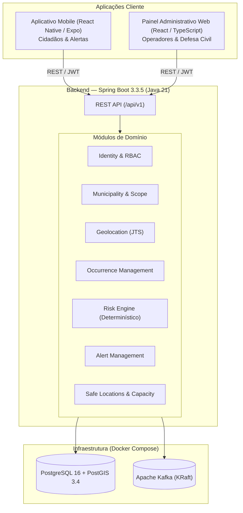

# Guardian

> **Sistema Inteligente de Monitoramento de Riscos e Orientação para Evacuação Urbana**
> 
> *Antecipar riscos. Informar pessoas. Proteger vidas.*

[]()
[]()
[]()
[]()
[]()
[](LICENSE)

---

## 1. Visão Geral

O **Guardian** é uma plataforma tecnológica integrada projetada para monitorar riscos geológicos e hidrológicos urbanos, centralizar relatos comunitários e viabilizar a comunicação rápida e contextualizada entre cidadãos e autoridades da Defesa Civil.

A solução combina:
- **Processamento Geoespacial (PostGIS / SRID 4326):** Delimitação de perímetros municipais e cálculo geodésico de distâncias (Haversine);
- **Avaliação Determinística de Riscos:** Explicabilidade total de fatores e pesos (RN020), sem tratar ausência de dados como normalidade (`INSUFFICIENT_DATA` / `STALE_DATA`);
- **Comunicação Oficial de Alertas:** Emissão controlada por operadores municipais com recomendações claras de autoproteção e encerramento com justificativa formal (RN033);
- **Acolhimento Humanitário:** Gestão de abrigos e pontos seguros com regra de segurança crítica (RN042 — abrigos lotados ou interditados nunca são apresentados como disponíveis).

---

## 2. Arquitetura do Sistema

O Guardian adota o padrão de **Monólito Modular (Modular Monolith)** no backend e aplicações clientes desacopladas:



---

## 3. Contas de Demonstração (DEMO_SCRIPT)

A aplicação conta com um inicializador de dados (`DemoDataInitializer`) que carrega automaticamente as contas de demonstração e municípios no início:

| Perfil | E-mail | Senha | Escopo de Acesso |
|---|---|---|---|
| **Cidadão** | `cidadao.demo@example.com` | `SenhaSegura@123` | Aplicativo móvel, consulta de riscos/alertas e relatos públicos |
| **Operador Municipal** | `operador.demo@example.com` | `SenhaSegura@123` | Painel web, triagem de relatos e emissão de alertas em São Paulo |
| **Administrador Global** | `admin.demo@example.com` | `SenhaSegura@123` | Gestão de municípios, operadores e configurações globais da plataforma |

---

## 4. Instruções de Instalação e Execução

### Pré-requisitos
- **Java 21 LTS** (`openjdk 21`)
- **Docker** e **Docker Compose**
- **Node.js 20+** e **npm**

---

### Passo 1: Iniciar a Infraestrutura de Banco e Mensageria
Na raiz do repositório:
```bash
docker compose up -d
```
Verifique se os contêineres `guardian-postgres` (porta 5432) e `guardian-kafka` (porta 9092) estão em execução:
```bash
docker compose ps
```

---

### Passo 2: Iniciar o Backend (Spring Boot)
```bash
cd backend
./mvnw spring-boot:run
```
O servidor REST iniciará em `http://localhost:8080`.
- **Swagger / Documentação Interativa:** [`http://localhost:8080/swagger-ui/index.html`](http://localhost:8080/swagger-ui/index.html)
- **Health Check da API:** [`http://localhost:8080/api/v1/health`](http://localhost:8080/api/v1/health)

---

### Passo 3: Iniciar o Painel Administrativo Web (`admin-web`)
Em um novo terminal:
```bash
cd admin-web
npm install
npm run dev
```
Acesse no navegador: **`http://localhost:3000`** (ou porta indicada no terminal).  
Utilize os botões de atalho de login com as contas demo.

---

### Passo 4: Iniciar o Aplicativo Móvel (`mobile`)
Em um novo terminal:
```bash
cd mobile
npm install
npm run web
```
Ou `npm run android` / `npm start` para executar no emulador Expo.

---

## 5. Testes Automatizados e Qualidade

Para executar toda a suíte de testes automatizados (unitários, repositórios, serviços, controllers e o fluxo End-to-End completo):
```bash
cd backend
./mvnw test
```
*Suíte aprovada com 100% de sucesso (125 testes sem falhas ou erros).*

### Coleção de Testes Insomnia
Para testes manuais guiados, importe o arquivo **[`insomnia-collection.json`](insomnia-collection.json)** diretamente no [Insomnia REST Client](https://insomnia.rest/).

---

## 6. Principais Regras de Negócio e Segurança

- **RN012 — Privacidade em Relatos Anônimos:** Relatos submetidos de forma anônima ou sem autenticação nunca vinculam dados pessoais do autor no banco de dados.
- **RN020 — Explicabilidade Determinística:** Nenhuma ausência de dados pode ser apresentada como confirmação de normalidade. As classificações contêm discriminação dos fatores contribuintes.
- **RN033 — Auditoria em Alertas:** O encerramento de alertas exige obrigatoriamente justificativa técnica formal registrada pela autoridade responsável.
- **RN042 — Disponibilidade Efetiva de Abrigos:** Locais lotados, interditados ou com capacidade desatualizada são estritamente ocultados das consultas de pontos disponíveis.
- **Isolamento Municipal:** Operadores municipais são estritamente restritos ao seu território cadastrado (rejeição automática de requisições cross-municipality com HTTP 403 Forbidden).

---

## 7. Licença

Este projeto é disponibilizado sob a licença [MIT](LICENSE).
