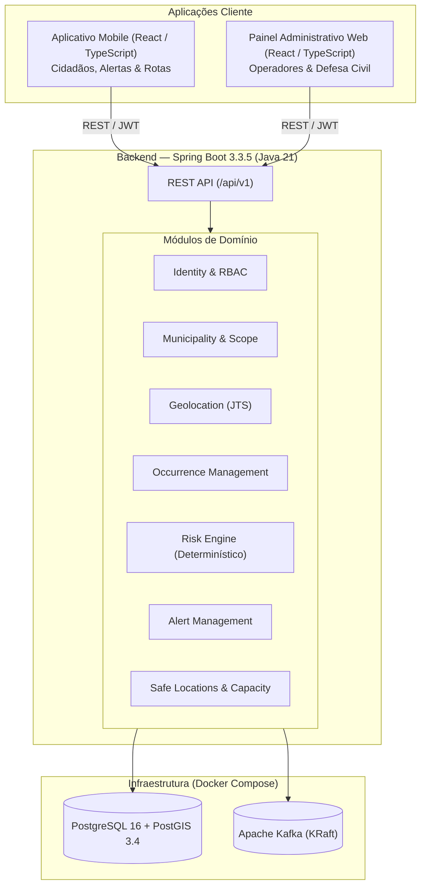

# Encosta Segura

> **Alertas de deslizamento e alagamento com IoT e Inteligência Artificial para quem mora em encostas e na beira de córregos.**
>
> *Antecipar riscos. Informar pessoas. Proteger vidas.*

[]()
[]()
[]()
[]()
[]()
[](LICENSE)

---

## Equipe
- **Davi Correa Paião** | RM: 560438
- **Gabriela Queiroga** | RM: 560035
- **Maria Eduarda Ferrés** | RM: 560418

---

## Ficha da CitizenTech

| Campo | Conteúdo |
|---|---|
| **Nome da CitizenTech** | Encosta Segura |
| **Desafio / Curso** | Global Solution 2026.2 · CitizenTech · FIAP · Engenharia de Software (3º ano) |
| **Cidade e bairro** | São Paulo – SP · [preencher: bairro/comunidade observada pela equipe] |
| **Cidadão beneficiado** | Moradores de encostas e de áreas alagáveis à beira de córregos; agentes da Defesa Civil |
| **Problema, em uma frase** | Quem mora em área de risco não recebe aviso a tempo de deslizamentos e alagamentos, nem sabe para onde ir quando o perigo chega. |
| **Como funciona** | Estações IoT medem o terreno e o córrego, modelos de risco calculam a probabilidade de desastre e a plataforma avisa cada morador com o que fazer e a rota segura até o ponto de apoio. |
| **O que cada parte faz** | **Backend / API:** recebe leituras e ocorrências, avalia riscos e dispara alertas · **App Mobile:** alerta, mapa, relatos e rota · **Painel Web / Defesa Civil:** triagem, emissão oficial de alertas e gestão de abrigos · **Borda IoT (ESP32) & IA/ML:** medição local, sinalização offline e previsão de risco. |
| **Indicador de impacto** | Minutos entre o alerta **ALTO** e a confirmação **"Estou seguro"** de cada família (meta: menos de 15 minutos) |
| **ODS conectados** | ODS 11 (Cidades e Comunidades Sustentáveis), ODS 13 (Ação Contra a Mudança Global do Clima), ODS 3 (Saúde e Bem-Estar), ODS 10 (Redução das Desigualdades), ODS 9 (Indústria, Inovação e Infraestrutura) |

---

## 1. Visão Geral e Proposta de Valor

O **Encosta Segura** é uma plataforma tecnológica integrada projetada para monitorar riscos geológicos e hidrológicos (deslizamentos de terra e alagamentos), centralizar relatos comunitários e viabilizar a comunicação rápida, local e contextualizada entre cidadãos em áreas vulneráveis e autoridades da Defesa Civil.

### O Problema
No Brasil, cerca de **8,9 milhões de pessoas** vivem em áreas mapeadas de risco de deslizamento, enxurrada e inundação (Governo Federal / Cemaden). Entre 2013 e 2025, desastres causaram **3.221 mortes** e **R$ 785 bilhões** em prejuízos aos municípios (CNM). São Paulo é a 2ª cidade do país com mais moradores em áreas de risco (674.329 pessoas).

Hoje, os alertas regionais (como SMS 40199) chegam por CEP ou município inteiro, sem informar qual encosta está cedendo, qual rua alaga primeiro ou para onde o morador deve ir — deixando famílias vulneráveis (incluindo crianças pequenas e idosos, que representam 17,7% dos moradores em áreas de risco) sem tempo de reação.

### Como o Encosta Segura Resolve

| Aspecto | Alerta Regional Atual (SMS 40199 / WhatsApp) | Encosta Segura |
|---|---|---|
| **Abrangência** | CEP ou município inteiro | Monitoramento local por encosta, córrego e área de risco |
| **Dado usado** | Previsão do tempo e pluviômetros regionais | Sensores locais (solo, chuva, inclinação e nível), dados geoespaciais e relatos comunitários |
| **O que diz ao morador** | Apenas que há risco na região | Se deve sair, o que fazer e a **rota segura até o ponto de apoio** |
| **Sem internet** | Depende do celular | Sinalização local (LEDs e sirene na estação) + SMS como reserva |
| **Retorno para a Defesa Civil** | Não sabe quem saiu de casa | Painel em tempo real com monitoramento e confirmações de segurança |

### Fluxo da Solução em 5 Passos
1. **Medir:** Estações e fontes de dados monitoram umidade do solo, chuva, inclinação do terreno e nível do córrego.
2. **Calcular:** O motor de risco avalia fatores determinísticos e modelos preditivos com explicabilidade total (RN020), sem tratar ausência de dados como normalidade (`INSUFFICIENT_DATA` / `STALE_DATA`).
3. **Avisar no local:** Sinalização visual e sonora local (LEDs verde, amarelo e vermelho, sirene e display) mesmo sem conexão com a internet.
4. **Enviar:** A API REST processa leituras, ocorrências geoespaciais (PostGIS / SRID 4326) e dispara alertas oficiais controlados pela Defesa Civil.
5. **Orientar:** O aplicativo exibe o nível do alerta (**BAIXO**, **ATENÇÃO** ou **ALTO**), instruções objetivas de autoproteção, abrigos disponíveis (RN042) e a rota até o ponto de apoio seguro.

---

## 2. Arquitetura do Sistema

O **Encosta Segura** adota o padrão de **Monólito Modular (Modular Monolith)** no backend e aplicações clientes desacopladas:



---

## 3. Contas de Demonstração (`DemoDataInitializer`)

A aplicação conta com um inicializador de dados (`DemoDataInitializer`) que carrega automaticamente as contas de demonstração e municípios no início:

| Perfil | E-mail | Senha | Escopo de Acesso |
|---|---|---|---|
| **Cidadão** | `cidadao.demo@example.com` | `SenhaSegura@123` | Aplicativo móvel, consulta de riscos/alertas, abrigos e relatos públicos |
| **Operador Municipal** | `operador.demo@example.com` | `SenhaSegura@123` | Painel web, triagem de relatos e emissão de alertas em São Paulo |
| **Administrador Global** | `admin.demo@example.com` | `SenhaSegura@123` | Gestão de municípios, operadores e configurações globais da plataforma |

---

## 4. Instruções de Instalação e Execução

### Pré-requisitos
- **Java 21 LTS** (`openjdk 21`)
- **Docker** e **Docker Compose**
- **Node.js 20+** e **npm**

---

### Passo 1: Iniciar a Infraestrutura de Banco e Mensageria
Na raiz do repositório:
```bash
docker compose up -d
```
Verifique se os contêineres `encosta-segura-postgres` (porta 5432) e `encosta-segura-kafka` (porta 9092) estão em execução:
```bash
docker compose ps
```

---

### Passo 2: Iniciar o Backend (Spring Boot)
```bash
cd backend
./mvnw spring-boot:run
```
O servidor REST iniciará em `http://localhost:8080`.
- **Swagger / Documentação Interativa:** [`http://localhost:8080/swagger-ui/index.html`](http://localhost:8080/swagger-ui/index.html)
- **Health Check da API:** [`http://localhost:8080/api/v1/health`](http://localhost:8080/api/v1/health)

---

### Passo 3: Iniciar o Painel Administrativo Web (`admin-web`)
Em um novo terminal:
```bash
cd admin-web
npm install
npm run dev
```
Acesse no navegador: **`http://localhost:3000`** (ou porta indicada no terminal).  
Utilize os botões de atalho de login com as contas demo.

---

### Passo 4: Iniciar o Aplicativo Móvel (`mobile`)
Em um novo terminal:
```bash
cd mobile
npm install
npm run web
```
Ou `npm run android` / `npm start` para executar no emulador.

---

## 5. Testes Automatizados e Qualidade

Para executar toda a suíte de testes automatizados (unitários, repositórios, serviços, controllers e o fluxo End-to-End completo):
```bash
cd backend
./mvnw test
```
*Suíte aprovada com 100% de sucesso (126 testes sem falhas ou erros).*

### Coleção de Testes Insomnia
Para testes manuais guiados, importe o arquivo **[`insomnia-collection.json`](insomnia-collection.json)** diretamente no [Insomnia REST Client](https://insomnia.rest/).

---

## 6. Principais Regras de Negócio, Segurança e Privacidade (LGPD)

- **RN012 — Privacidade em Relatos Anônimos:** Relatos submetidos de forma anônima ou sem autenticação nunca vinculam dados pessoais do autor no banco de dados.
- **RN020 — Explicabilidade Determinística:** Nenhuma ausência de dados pode ser apresentada como confirmação de normalidade. As classificações contêm discriminação dos fatores contribuintes.
- **RN033 — Auditoria em Alertas:** O encerramento de alertas exige obrigatoriamente justificativa técnica formal registrada pela autoridade responsável.
- **RN042 — Disponibilidade Efetiva de Abrigos:** Locais lotados, interditados ou com capacidade desatualizada são estritamente ocultados das consultas de pontos disponíveis.
- **Isolamento Municipal:** Operadores municipais são estritamente restritos ao seu território cadastrado (rejeição automática de requisições cross-municipality com HTTP 403 Forbidden).
- **LGPD (Dados Mínimos):** Coleta restrita ao estritamente necessário para emissão de alertas e orientação de rota, sem armazenamento de histórico contínuo de localização do morador.

---

## 7. Impacto Social e ODS

| ODS | Contribuição do Encosta Segura |
|---|---|
| **ODS 11** · Cidades e comunidades sustentáveis | Reduz mortes e perdas causadas por desastres em comunidades vulneráveis (meta 11.5). |
| **ODS 13** · Ação contra a mudança global do clima | Fortalece a capacidade de adaptação a chuvas extremas com alerta precoce (meta 13.1). |
| **ODS 3** · Saúde e bem-estar | Evita ferimentos e mortes por meio da evacuação antecipada e guiada. |
| **ODS 10** · Redução das desigualdades | Leva tecnologia de alerta gratuita a moradores de áreas mais expostas. |
| **ODS 9** · Indústria, inovação e infraestrutura | Combina IoT de baixo custo, IA e arquitetura modular para infraestrutura de monitoramento. |

> **Aviso importante:** O **Encosta Segura** é um protótipo acadêmico (Global Solution 2026.2 · FIAP). Em uma emergência real, siga sempre as orientações oficiais da **Defesa Civil (199)** e do **Corpo de Bombeiros (193)**.

---

## 8. Licença

Este projeto é disponibilizado sob a licença [MIT](LICENSE).
